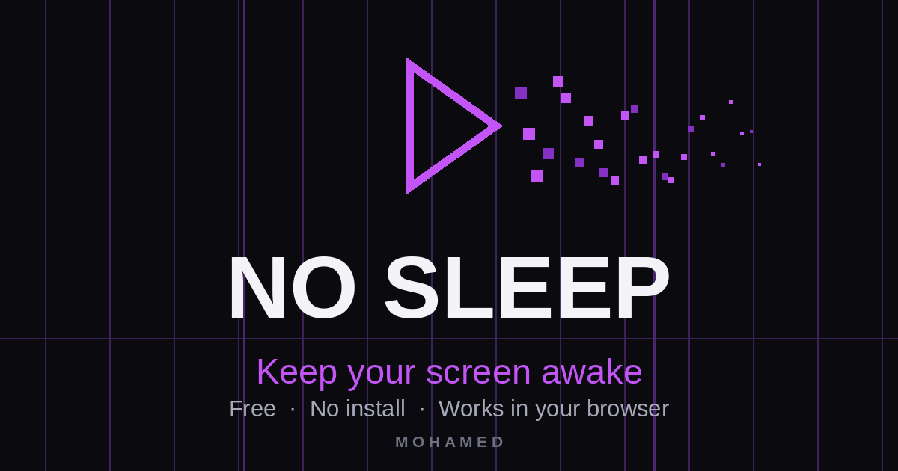

# No Sleep — Keep Your Screen Awake

**A free online wake lock tool. One click keeps your screen awake — no install, no sign-up, no admin rights.**

### ▶ Use it now: [mohamedelsherbiny369.github.io/nosleep](https://mohamedelsherbiny369.github.io/nosleep/)

No Sleep prevents your computer screen from dimming, sleeping or locking while you work. It runs entirely in your web browser using the **Screen Wake Lock API**, so it works even on **work and school laptops** where the power settings are locked down and you can't install software.

## How to use it

1. Open [the tool](https://mohamedelsherbiny369.github.io/nosleep/) and leave the tab open.
2. **Click the logo** to switch it on — the status changes from "Sleep allowed" to "No Sleep".
3. Pick a duration: presets from **30 minutes to 8 hours**, a custom length (**1–720 minutes**), or **Until** a clock time you choose.
4. Pause, resume, stop or reset whenever you like — or **pop out** a small floating window that stays on top while you work in other apps.

## Features

- One-click wake lock using the Screen Wake Lock API
- Timer presets (30m · 1h · 2h · 4h · 8h), custom durations and an "Until" clock-time mode
- Live countdown, progress bar and an elapsed "awake" timer
- Pop-out floating window (Document Picture-in-Picture) on supported desktop browsers
- Works on phones and tablets in browsers that support the Wake Lock API
- Nothing to install, no account, no tracking — close the tab and everything stops

## When it's useful

- Work laptops where the screen locks during long reads, builds or calls
- Presentations and demos that can't dim mid-slide
- Long downloads, uploads and renders
- Dashboards and monitoring screens that must stay visible
- Reading and studying without tapping the mouse every few minutes

## Browser support

Full support in **Chrome, Edge and other Chromium browsers**, and **Safari 16.4+**. In browsers without the Wake Lock API the timer still runs and the page warns you that the screen may still sleep. A wake lock holds while the tab is open; it cannot prevent sleep when the laptop lid is closed (no web tool can).

📖 **Full guide & FAQ:** [How No Sleep works](https://mohamedelsherbiny369.github.io/nosleep/guide.html)

## Built with

Plain HTML, CSS and JavaScript — no build step, no dependencies. The interface is drawn from a neon architectural wallpaper: a chamber of tall panels whose edges carry a travelling light while the tool is on.

---

By **Mohamed** · More tools to come.
